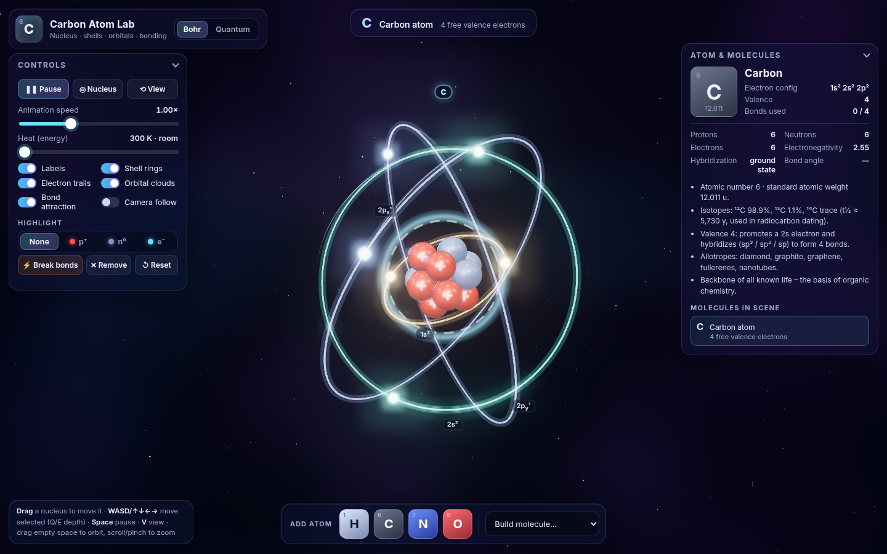
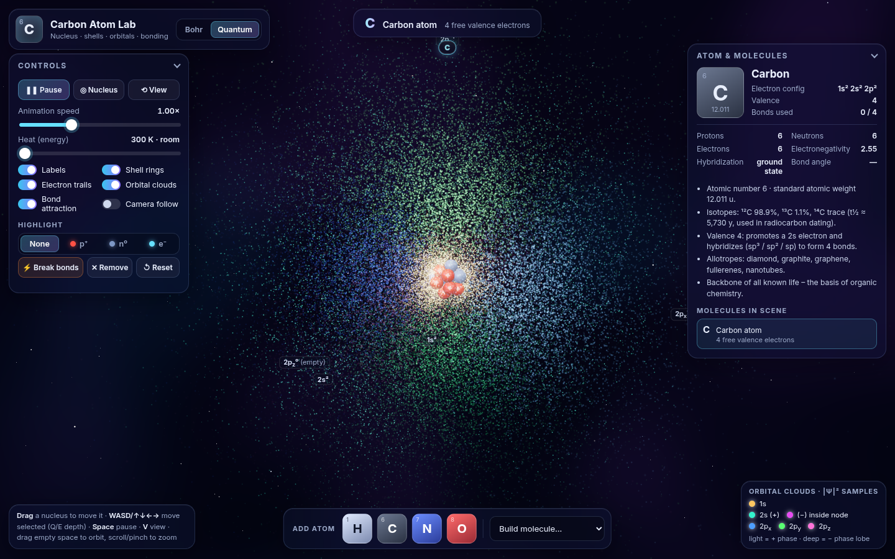
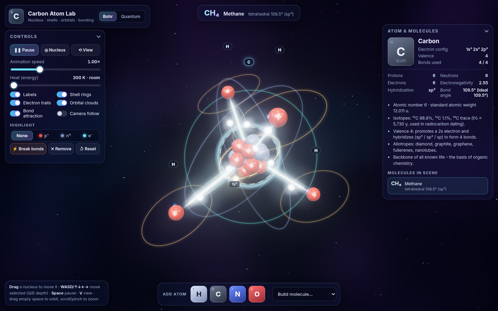
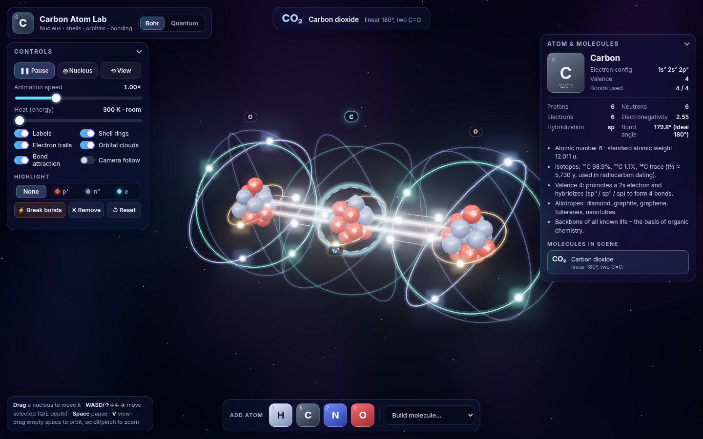

# Carbon Atom Lab: interactive 3D atom and bonding sandbox

A self-contained, no-build static web app that renders a **carbon atom** in real time 3D with Three.js:
a jiggling nucleus made of 6 protons and 6 neutrons, Bohr-style glowing electron shells with trails,
a **quantum view** of the real orbital probability clouds (1s, 2s, 2p), and a **chemistry sandbox** where you
drag atoms together and watch covalent bonds form with realistic geometry.



| Quantum orbitals | Methane CH₄ (109.5°) | Carbon dioxide CO₂ (180°, two C=O) |
|---|---|---|
|  |  |  |

## Run it

No build step and no dependencies to install. Three.js r160 loads from the jsDelivr CDN through an ES-module `importmap`.
You need an internet connection the first time.

```bash
cd interactive-atoms
python3 -m http.server 8000
# open http://localhost:8000
```

> ES modules don't load from `file://`, so serve the folder over HTTP.
> **GitHub Pages:** push the folder to a repo and enable Pages on the branch root. `index.html` works as-is.

## Features

### The atom
* **Nucleus:** 6 p⁺ (red, each marked with a glowing **+** that always faces the camera) and 6 n⁰ (steel-blue). They are packed by a
  small relaxation solver into a tight cluster and **jiggle** continuously, faster with heat. Materials use `MeshPhysicalMaterial`
  (clearcoat and a touch of iridescence) under a PMREM room environment, key/rim/fill lights, and **UnrealBloom** post-processing on an
  MSAA half-float render target.
* **Electrons in the correct configuration 1s² 2s² 2p²:** one glowing ring per occupied orbital (1s gold, 2s teal, 2p blue).
  Following Hund's rule, carbon has **2pₓ¹ 2pᵧ¹** and an empty 2p_z. Electrons orbit smoothly with fading additive **trails**, and the ring planes precess slowly.
* **Quantum view:** point-sprite clouds sampled from the hydrogen-like **|ψ|²** (exact Gamma sampling for 1s and 2p, rejection
  sampling for 2s). Each point is brightness-weighted by its density, so lobes read clearly.
  * 1s: compact gold sphere.
  * 2s: sphere with a **radial node** at r = 2a₀. The inner (−) region is magenta, the outer (+) region teal, and a cut-away wedge lets you see inside.
  * 2p: **dumbbells along x, y and z** (blue, green and pink). Light and deep shades show the + and − phase lobes. The empty 2p_z is drawn faintly.
  * The nucleus shrinks in this view so the orbital cores are visible (it's really ~100,000× smaller than the atom).
* The background is a gradient nebula dome with a twinkling starfield.

### Controls (glass UI panel)
* OrbitControls with damping: rotate, zoom (scroll or pinch), pan.
* Play/Pause, **animation speed**, **heat** (300 K to 6000 K).
* Toggles: labels, shell rings, electron trails, orbital clouds, bond attraction assist, camera follow.
* **Highlight** protons, neutrons or electrons. The chosen particle type pulses and the others fade.
* **◎ Nucleus** flies the camera into the selected nucleus. **⟲ View** frames the whole scene.
* **Info panel:** element tile (Z, mass), electron configuration, valence, bonds used, p/n/e counts, electronegativity,
  hybridization (sp³ / sp² / sp), live measured bond angle against the ideal, element facts, and the list of molecules in the scene.
* **Tooltips** on hover (tap on touch):
  * proton/neutron: charge, mass, quark content
  * electron: orbital, n, ℓ, spin, and whether it is orbiting or shared in a σ/π bond
  * bond: order, length, bond enthalpy (kJ/mol), polarity

### Moving atoms and chemistry
* **Drag any nucleus** (mouse or touch) to move that atom. Bonded partners follow through spring physics.
  You can also move the selected atom with **WASD / arrow keys** (Q/E for depth). Click a nucleus or press Tab to select.
* **Palette:** spawn **H, C, N, O** (keys 1–4), or pick a ready-made molecule from *Build molecule…*.
* **Valence is enforced:** H = 1, O = 2, N = 3, C = 4.
  * When two atoms with free valence get close, a **covalent bond** forms. One electron from each atom leaves its shell and the
    **shared pair animates** around the bond: a σ pair loops along the axis, and π pairs ride above and below it.
  * The bond appears with a glow flash and a colour gradient between the two elements.
  * If both atoms still have free valence after a moment, the bond is promoted to a **double or triple bond** (CO₂, C≡N, C≡C).
  * An atom approaching a saturated multiple bond can "open" it (addition), so C≡C plus H atoms gives ethylene and then ethane.
* **Geometry snaps to VSEPR shapes** through bond springs, angle springs and Urey-Bradley 1–3 springs, with domain counting that includes lone pairs:
  * CH₄ tetrahedral 109.5°
  * NH₃ 107°
  * H₂O 104.5°
  * CH₂O / C₂H₄ trigonal 120°
  * CO₂ / HCN / C₂H₂ linear 180°
* **Physics:** semi-implicit Euler integration with 4 substeps per frame, damped springs, soft non-bonded repulsion, an optional gentle
  attraction between atoms that can bond, a soft world boundary and Langevin thermal noise.
* **Heat:** atoms vibrate harder, and bonds dissociate with an Arrhenius-like rate `∝ exp(−E_bond / T)` that uses real bond enthalpies.
  Weak bonds go first, and multiple bonds step down one order at a time. Cool the system down and fragments can re-bond.
  **⚡ Break bonds** splits everything at once.
* **Status readout:** names the molecule that contains the selected atom, using its Hill formula and connectivity. Recognised molecules include:
  * hydrocarbons: CH₄ methane, C₂H₆ ethane, C₂H₄ ethylene, C₂H₂ acetylene, C₃H₈ propane
  * carbon oxides: CO₂ carbon dioxide, CO carbon monoxide
  * nitrogen compounds: HCN (versus HNC), NH₃ ammonia, N₂
  * oxygen compounds: H₂O water, CH₂O formaldehyde, CH₃OH methanol, HCOOH formic acid, ethanol versus dimethyl ether
  * diatomic gases: H₂, O₂
  * radicals: CH₃•, OH•, and others

  Toasts announce each bond and each newly completed molecule.

### Performance
* Instanced meshes for all protons, neutrons, electrons and bond tubes. A single `LineSegments` buffer holds every trail. Shared orbital geometry is used across atoms.
* `devicePixelRatio` is capped at 2, with **adaptive resolution** that steps the pixel ratio down if fps drops below 45.
* Handles window resize. Touch-friendly hit areas and a responsive layout with collapsible panels on phones.

### Keyboard
| Key | Action |
|---|---|
| Drag nucleus / WASD / arrows / Q E | move atom |
| Space | play / pause |
| V | Bohr ↔ quantum |
| L | labels |
| N | fly into nucleus |
| F | frame scene |
| B | break all bonds |
| 1 2 3 4 | spawn H C N O |
| Tab | select next atom |
| Delete | remove selected |
| Shift+R | reset |

## URL parameters / debug hook

| Param | Example | Effect |
|---|---|---|
| `demo` | `?demo=ch4` | Prebuilt molecule: `ch4 co2 co c2h6 c2h4 c2h2 hcn h2o nh3 ch3oh sandbox` |
| `view` | `?view=quantum` | Start in the orbital view |
| `heat`, `speed` | `?heat=0.6&speed=2` | Initial sliders (heat 0–1) |
| `highlight` | `?highlight=proton` | `proton`, `neutron`, `electron` |
| `zoom` | `?zoom=nucleus` | Start zoomed into the nucleus |
| `labels=0`, `paused=1`, `ui=0`, `fps` | | Hide labels, start paused, hide UI, show fps meter |

`window.atomLab` exposes the following for automation and experiments:
* `loadDemo(name)`, `spawn('H')`, `setView('quantum')`, `setHeat(0.8)`
* `advance(seconds)`, which fast-forwards the physics without rendering
* `state()`, which returns atoms, bonds with lengths in Å, molecules and measured angles

## Tests

`tests/screenshots.cjs` is a Playwright script. It does the following:
1. Loads each view and checks for **zero console errors**, page errors and failed requests.
2. Captures the screenshots in `screenshots/`.
3. Drags the carbon with the mouse.
4. Builds CH₄ by spawning H atoms, then heats it until bonds break.
5. Verifies that free atoms placed near each other self-assemble with the right geometry: CO₂ 180°, H₂O 104.5°, HCN 180°, NH₃ 107°, C₂H₆ 109.5°.
6. Tests keyboard movement and renders a phone viewport.

```bash
python3 -m http.server 8812 --bind 127.0.0.1 &
npm i playwright && npx playwright install chromium   # once
node tests/screenshots.cjs http://127.0.0.1:8812/
```

## Project layout

```
index.html          UI markup + importmap
css/style.css       glassmorphism UI, responsive layout
js/main.js          renderer, bloom, camera, input (drag/keys/touch), UI wiring, demos, debug hook
js/world.js         atoms, electrons, bonds, physics, chemistry rules, molecule naming, instanced rendering, picking
js/orbitals.js      |ψ|² sampling for 1s/2s/2p and the point-cloud shader
js/background.js    nebula gradient dome + starfield
js/data.js          element data, bond lengths/enthalpies, molecule names
tests/              headless Playwright smoke test
screenshots/        captured output
```

## Honest simplifications
* **Not to scale.** The nucleus is drawn about 10⁴ times too large so you can see it. Bond lengths use real covalent radii, and Å are scaled ×3 to world units.
* **Bohr rings are a teaching picture.** Electrons do not orbit on circles. The quantum view shows the actual probability densities,
  but these are hydrogen-like orbitals sampled with Z = 1 shapes and scaled. They are not Hartree-Fock orbitals, and molecular orbitals are not computed
  (bonded atoms keep their atomic clouds in the quantum view).
* **Bonding is rule-based.** It uses valence counting and VSEPR, not quantum chemistry. CO is shown as C=O (the real molecule has a triple bond with a dative
  component), carbenes and radicals use simple geometry, and ring closure inside one molecule is disabled.
* Dihedral angles are not constrained, so ethane rotates freely about its C–C bond, which is roughly right anyway.
